# 수집 구조 문서 (이전 설계 기준)

> 작성 기준: `Insurance-math/actuary-news-hub` main, 2026-11-11. 조사 전용 문서다(코드·데이터·배포 변경 없음).
> 목적: 새 저장소 `heukseoknews/heukseoknews.github.io`(서비스 이름 **흑석일보**, `https://heukseoknews.github.io/`)로 옮기고 **채널(보험·AI·금융)** 구조로 정리하기 전에, 현재 구조를 한 문서로 고정한다.
> 숫자는 `python scripts/audit/funnel.py` 로 다시 뽑을 수 있다(`data/status.json`·`data/*.json` 읽기 전용).

## 목차
1. 전체 흐름도
2. 소스 표
3. 퍼널 숫자(최근 실행)
4. 데이터 스키마
5. 설정 파일·코드 지도와 하드코딩 목록
6. 보험 전용 vs 범용 구분
7. 워크플로·운영
8. 채널 구조 초안과 이전 계획

---

## 1. 전체 흐름도

```mermaid
flowchart TD
  A["① 시작<br/>Actions 스케줄(cron 37 20 * * * UTC = 05:37 KST) · workflow_dispatch<br/>(push 는 수집 없이 빌드·배포만)"] --> B
  B["② 소스별 가져오기<br/>collect.main → load_sources / boards.json<br/>RSS(3+금융위) · 구글 뉴스 검색(25 쿼리) · HTML 게시판(3)"] --> C
  C["③ 정규화<br/>collect_source: parse_date(KST 보정) · clean · 제목 끝 '- 언론사' 분리<br/>SourceAliases.resolve(출처 정규화) · strip_org_suffix"] --> D
  D["④ 필터(저장 전)<br/>링크·날짜 없음 · max_age_days(검색 피드 180일) · TitleFilter.is_junk<br/>Blocked.is_blocked"] --> E
  E["⑤ 판정·분류<br/>make_article → judge: classify(제목)<br/>relevant = relevance_keywords ∨ 보험과 글 ∨ 보험사 언급 − 스포츠 구단 − PRESS_RE(press)<br/>relevant=false 이면 category=미분류(버리지 않고 저장)"] --> F
  F["⑥ 엔터티·태그·점수<br/>tag_entities → companies · orgs, 같은 이름 태그 제거<br/>Classifier.score → ★(base 2 + 키워드·핵심어 가산, 상한 규칙)"] --> G
  G["⑦ 소스 간 중복 제거<br/>merge_found: dedupe_key(제목+출처) · prefer(직접 링크 > 구글 링크, press > media, relevant)"] --> H
  H["⑧ 저장<br/>save: normalize_shards → 발행월(UTC) 샤드 병합(기존 id 유지)<br/>data/YYYY-MM.json · index.json · write_status → status.json · write_trends → trends.json"] --> I
  I["⑨ 커밋<br/>scripts/commit-data.sh (push 3회 재시도, 충돌 시 이쪽 data 우선)"] --> J
  J["⑩ 빌드·배포<br/>npm test → sync-data(public/data) → version.json → next build(export) → Pages"] --> K
  K["⑪ 브라우저<br/>lib/useNews(index → 최근 2개월 + 달력 월 ±1, 검색 시 전체) · 필터(탭·카테고리·언론사·보험사·유관기관·날짜·검색) · localStorage"]
```



단계별 담당 파일과 입출력:

| # | 단계 | 담당(파일·함수) | 입력 → 출력(필드) |
|---|---|---|---|
| ① | 시작 | `.github/workflows/deploy.yml` | cron/수동 → `python collector/collect.py` 실행(앞서 `collector/test_*.py` 전부 실행) |
| ② | 가져오기 | `collect.py` `load_sources`(RSS_SOURCES + `config/feeds.json`), `collect_source`(RSS/구글), `collect_board`→`boards.py` `fetch_board`·`parse_fsc`·`parse_fss`(게시판), `throttle_google`(0.6초) | URL/쿼리 → 항목(title, link, 날짜, 담당부서) |
| ③ | 정규화 | `parse_date`(타임존 없는 국내 RSS는 KST→UTC −9h), `clean`, 제목 `- 언론사` 분리, `normalize.SourceAliases.resolve`(도메인→이름 순), `normalize.strip_org_suffix`, `article_id`(정규화 URL 해시 16자) | → title, source, published_at(UTC ISO), id |
| ④ | 저장 전 필터 | `collect_source`(no_link/no_date, `max_age_days`), `TitleFilter.is_junk`(`title_filters.json`), `Blocked.is_blocked`(`blocked_sources.json`) | 걸러진 건수는 `skipped`·`blocked` 로 status 에 기록 |
| ⑤ | 판정·분류 | `collect.judge`, `classify.Classifier.classify`(카테고리 8개+미분류, tags, sub_categories), `entities.company_relevant`·`sports_team_title` | → category, sub_categories, tags, **relevant** |
| ⑥ | 엔터티·점수 | `entities.tag_entities`, `Classifier.score`(`score.json`) | → companies, orgs, (tags 정리), score |
| ⑦ | 중복 제거 | `collect.merge_found`, `normalize.dedupe_key`·`prefer` | 소스 간 중복 병합 → candidates |
| ⑧ | 저장 | `collect.save`(+`normalize_shards`), `write_status`, `trends.write_trends` | → `data/YYYY-MM.json`, `index.json`, `status.json`, `trends.json` |
| ⑨ | 커밋 | `scripts/commit-data.sh` | `data:` 커밋을 main 에 push |
| ⑩ | 빌드·배포 | `deploy.yml` build/deploy 잡, `scripts/sync-data.mjs`, `scripts/make-version.mjs` | `out/` → GitHub Pages, `version.json` |
| ⑪ | 브라우저 | `lib/useNews.ts`, `lib/useSaved.ts`, `lib/facets.ts`, `lib/newsFilter.ts`, `app/page.tsx` | JSON → 목록·필터·북마크·읽음 |

재분류 경로(네트워크 없음): `collect.py --reclassify`(분류·태그·점수·relevant·companies·orgs 재계산), `--rescore`(점수만), `--reindex`(index·trends 재생성), `--backfill`(게시판을 더 깊이).

---

## 2. 소스 표

최근 실행 기준(2026-11-11 08:27 UTC 수동 실행). "상한"은 피드가 준 항목 수가 50/100건에 닿았는지, "쿼리 분할 필요"는 구글 검색 쿼리가 100건에 닿았다는 뜻이다. 저장 후보(kept)에는 관련도 낮음이 포함된다. 숫자의 근거는 `scripts/audit/funnel.py`.

### 2.1 종류별 공통 규칙

| 종류 | 가져오기 | 출처 표기(정규화) | 실패 시 | 비고 |
|---|---|---|---|---|
| 직접 RSS (`RSS_SOURCES`) | `requests.get`(타임아웃 15초) → `feedparser` | 고정 출처명(`보험매일` 등) 그대로 | 그 소스만 `ok:false`, 다른 소스 계속, 기존 데이터 유지 | 항목 50건 → 피드 자체 상한 |
| 구글 뉴스 검색 (`config/feeds.json`) | `news.google.com/rss/search?q=…+when:{기간}&hl=ko&gl=KR` | 제목 끝 `- 언론사`에서 추출 → `<source url>` 도메인(우선) → 이름 순으로 `source_aliases.json` 정규화. 미매핑 이름은 그대로(+로그) | 위와 같음 | 쿼리당 100건 상한. 링크는 구글 중간 링크(원문으로 안 풀림, 직접 링크가 따로 있으면 그쪽이 우선) |
| HTML 게시판 (`config/boards.json`) | `boards.fetch_board`(요청 간격 ≥1.2초, 평소 2페이지, `--backfill` 3~4페이지) | 고정(`금융위원회`/`금융감독원`) | 첫 페이지 추출 0건 → "구조 변경 의심" 실패, 기존 데이터 보존 | 영구 링크(`/no010101/{id}`, `view.do?nttId=`), 담당부서 `department` 저장 |

### 2.2 소스별

| 소스 | 종류 | 주소 / 쿼리 | 피드 항목 | 후보(kept) | 관련도 낮음 | 걸러짐(오래/노이즈) | 상한 | 쿼리 분할 필요 | 저장분 중 이 소스 | 힌트 |
|---|---|---|---:|---:|---:|---|---|---|---:|---|
| 보험매일 | RSS | `fins.co.kr/rss/allArticle.xml` | 50 | 50 | 15 | - | 도달 | - | 112 | |
| 보험저널 | RSS | `insjournal.co.kr/rss/allArticle.xml` | 50 | 50 | 15 | - | 도달 | - | 99 | |
| 한국보험신문 | RSS | `insnews.co.kr/rss/allArticle.xml` | 50 | 50 | 23 | - | 도달 | - | 85 | |
| 금융위원회 RSS | RSS(press) | `fsc.go.kr/about/fsc_bbs_rss/?fid=0111` | 0 | 0 | 0 | - | - | - | 0 | **503 점검 중** → '참고' 표시(게시판 대체) |
| 주요 경제지·보험 | 검색 | `보험 (site:hankyung.com OR site:mk.co.kr OR … )` | 100 | 100 | 17 | - | 도달 | **예** | 217 | |
| 주요 경제지·금융시장 | 검색 | `(국고채 OR 금리 OR 환율 OR 보험사 자산운용) (site:…)` | 100 | 100 | 72 | - | 도달 | **예** | 166 | feed_hint: 금융시장·자산운용 |
| 사회변화·보험 | 검색 | `(고령화 OR 저출산 OR 인공지능 OR 기후위기 OR 의료비) 보험` | 31 | 31 | 2 | - | - | - | 98 | feed_hint: 사회·인구·기술 변화 |
| 금융위원회 검색 | 검색(press) | `site:fsc.go.kr (보험 OR K-ICS OR 실손 OR 생명보험 OR 손해보험)` | 48 | 24 | 23 | 3 / 21 | - | - | 13 | 고정 출처 금융위원회 |
| 금융감독원 검색 | 검색(press) | `site:fss.or.kr (보험 OR 보험사 OR 지급여력 OR 실손 OR K-ICS)` | 6 | 3 | 3 | 2 / 1 | - | - | 2 | 고정 출처 금융감독원 |
| 자동차보험 | 검색 | `(자동차보험 OR 자보 OR 대인배상 OR 대물배상 OR 자차보험)` | 35 | 30 | 8 | 차단 5 | - | - | 32 | |
| 자동차보험·제도 | 검색 | `(정비수가 OR 과실비율 OR 경상환자 OR 한방치료 OR 렌트비 OR 자동차보험료)` | 33 | 33 | 14 | - | - | - | 28 | |
| 기관·금융감독원 / 금융위원회 / 보험개발원 / 손해보험협회 / 생명보험협회 / 보험연구원 | 검색 6개 | `금융감독원 (보험 OR 보험사 OR 보험업)` 등 | 32 / 27 / 20 / 30 / 37 / 37 | 동일 | 11 / 6 / 3 / 7 / 1 / 0 | - | - | - | 22 / 15 / 15 / 22 / 28 / 17 | |
| 재보험 | 검색 | `(재보험 OR 코리안리)` | 23 | 23 | 2 | - | - | - | 21 | |
| 생보사 4개 | 검색 | 삼성·한화 / 교보·신한·농협 / 중소(국내) `-배구…` / 업권·외국계 | 69 / 62 / 74 / 69 | 69 / 61 / 74 / 66 | 6 / 0 / 0 / 7 | - | - | - | 27 / 30 / 53 / 37 | 일부 `when:3d` |
| 손보사 6개 | 검색 | 삼성화재(캐노피우스) `when:1d` / 삼성화재(그 외) / 현대해상 / DB·KB `3d` / 메리츠·한화 / 중소·인터넷 / 손보업권 | 40 / 43 / 67 / 90 / 80 / 97 / 36 | 동일 | 0 / 10 / 1 / 8 / 2 / 25 / 0 | - | - | - | 25 / 38 / 54 / 60 / 68 / 78 / 8 | 제외어 `-배구` 등 |
| 금융위원회 게시판 | 게시판 | `fsc.go.kr/no010101` (2페이지) | 20 | 20 | 19 | - | - | - | 38 | 담당부서 `보험과` 글은 항상 relevant |
| 금융위원회 보험과 게시판 | 게시판 | `…?srchKey=dept&srchText=보험과` | 20 | 20 | 0 | - | - | - | 20 | 〃 |
| 금융감독원 게시판 | 게시판 | `fss.or.kr/fss/bbs/B0000188/list.do?menuNo=200218` | 20 | 20 | 18 | - | - | - | 40 | |

- 쿼리는 현재 25개(상한 25개에 도달 — 더 늘리려면 기존 쿼리를 합치거나 직접 소스로 대체). 쿼리별 `when`(검색 기간)은 기본 7d, 기사가 몰리는 쿼리만 1~3d.
- 구글 링크가 1,350/1,744건(77%)이다. 구글 링크는 클릭하면 구글 뉴스를 거쳐 원문으로 이동한다.
- 직접 RSS 3개는 항목 50건 상한이라 매 실행마다 "상한 도달"로 뜬다(수집이 매일 돌아 겹침이 충분하다는 가정).

---

## 3. 퍼널 숫자 (최근 실행)

실행 시작 2026-11-11T08:27:45Z (수동 실행, 소요 약 35초).

| 단계 | 건수 | 비고 |
|---|---:|---|
| 소스가 준 항목(피드 항목 합) | 1,496 | 성공한 소스만 |
| − 링크·날짜 없음 | 0 | |
| − 오래된 글 차단(검색 피드 180일) | 5 | `max_age_days` |
| − 노이즈 제목(`title_filters`) | 22 | 대부분 금융위 검색(21) |
| − 출처 차단(`blocked_sources`) | 9 | Vietnam.vn 5, VOI.ID 4 (소스별 건수는 status 에 없음 — 합계만) |
| = 소스별 후보(kept 합) | 1,460 | 이 중 **관련도 낮음 318건 포함** |
| − 소스 간 중복 제거(제목+출처) | 224 | 같은 기사가 여러 쿼리에 걸림 |
| = 후보(candidates) | 1,236 | |
| − 이미 저장된 기사와 중복 | 732 | |
| = **신규 저장(added)** | **504** | |

현재 저장 데이터: 전체 1,744건 / 관련 1,408 / 관련도 낮음 336. 월 파일 2026-11 약 1.1MB, 2026-10 61KB(나머지 월은 수 KB).
카테고리(관련): 손해보험 479, 생명보험 328, 미분류 188, 금융시장·자산운용 101, 보험경영·판매 80, 사회·인구·기술 변화 65, 자동차보험 59, 제도·회계·건전성 59, 위험관리·재보험 49. ★(관련): ★2 957, ★3 337, ★4 100, ★5 14. companies 매칭 778건, orgs 매칭 253건.

주의: "관련도 낮음"은 저장 단계에서 버리지 않는다(화면 기본 숨김). 따라서 퍼널의 '관련 없음' 단계는 제외가 아니라 **표시 구분**이다(저장 1,460건 중 318건).

---

## 4. 데이터 스키마

### 4.1 `data/` 파일 구조

| 파일 | 내용 | 만드는 곳 | 읽는 곳 |
|---|---|---|---|
| `YYYY-MM.json` | 기사 배열(발행시각 UTC 월 기준, 최신순). 자동 삭제 없음 | `collect.save` | 화면 `lib/useNews` |
| `index.json` | `{updated_at, months:[{month,count,bytes}]}` (최신 월이 앞) | `collect.save` / `reclassify` / `reindex` | `lib/useNews`(어느 월을 받을지), 헤더·목록의 "마지막 수집" |
| `status.json` | 마지막 실행 요약 + 소스별 상태(아래 4.3) | `collect.write_status` | 상태 페이지, 헤더 배지, 지연 배너, 푸터 |
| `trends.json` | 주별(KST, 월요일 시작) 키워드 언급 수(관련 기사만) | `trends.write_trends`(`config/keywords.json`) | 키워드 추이 페이지 |
| `version.json`(빌드 산출물, `public/`) | commit, commit_message, built_at(KST), run_id, trigger, data_collected_at | `scripts/make-version.mjs` | 푸터·상태 페이지 |

### 4.2 기사 한 건 (`YYYY-MM.json` 의 원소)

| 필드 | 타입 | 값 예시 | 채우는 곳 | 화면 사용 |
|---|---|---|---|---|
| `id` | string(16) | `a12d2a1696182e95` | `article_id` = 정규화 URL(추적 파라미터 제거) SHA-256 앞 16자 | 읽음·북마크 키, React key |
| `title` | string | `메리츠증권 "내년 …" ` | 수집(제목 끝 `- 언론사`·기관 접미 제거) | 예 |
| `url` | string | 구글 뉴스 중간 링크 / 직접 링크 | 수집 | 예(새 탭 링크, 구글 링크 여부로 수집경로 표기) |
| `source` | string | `머니투데이`, `금융위원회` | 정규화된 출처 | 예(카드, 언론사 필터) |
| `source_type` | `media`\|`press` | `media` | 소스 설정 | 예(감독당국 탭 = press) |
| `published_at` | ISO UTC | `2026-11-11T08:21:02+00:00` | 피드 날짜(국내 RSS는 KST→UTC 보정). 게시판은 날짜만이라 KST 09:00 | 예(날짜·정렬·"새 뉴스") |
| `collected_at` | ISO UTC | `2026-11-11T08:27:45…` | 수집 실행 시각 | 예(새 뉴스 판정 기준) |
| `category` | string | `손해보험`, `자동차보험`, `미분류` | `Classifier.classify`(relevant=false 면 `미분류`) | 예(카테고리 탭, 배지) |
| `sub_categories` | string[] | `["금융시장·자산운용"]` | `classify` | **아니오**(저장만, 화면 미사용) |
| `tags` | string[] | `["손해율","보험료"]` | `classify` 키워드 히트(최대 5, 보험사·기관 이름 제외) | 예(카드 태그, 검색) |
| `score` | int 2~5 | `4` | `Classifier.score` | 예(★, 중요도순, 이번 주 핵심) |
| `feed_name` | string | `주요 경제지·금융시장` | 소스 이름 | 거의 아니오(감독당국 탭에서 `공식 RSS`/`검색으로 발견` 구분 1곳) |
| `relevant` | bool | `false` | `collect.judge`(없으면 true 로 간주) | 예(기본 숨김·토글, 새 뉴스 건수·이번 주 핵심·추이 제외) |
| `companies` | string[] | `["삼성화재","캐노피우스"]` | `entities.tag_entities`(`companies.json`) | 예(보험사 필터, 태그, 검색) |
| `orgs` | string[] | `["금융감독원"]` | 〃(`orgs.json`, 공식 출처 포함) | 예(유관기관 필터, 태그, 검색) |
| `department` | string(선택) | `보험과` | 게시판 담당부서 | **아니오**(내부 메타; `relevant` 판정에만 사용) |

본문·요약·이미지는 저장하지 않는다(제목·링크·출처·시각·메타만).

### 4.3 `status.json`

- `last_run`: `started_at`, `finished_at`, `candidates`, `added`, `failed[]`(참고 처리된 것 제외), `noted[]`(예: 금융위 RSS), `blocked{출처:건수}`.
- `sources[이름]`: `ok`, `last_run_at`, `last_success_at`, `consecutive_failures`, `entries`, `kept`, `skipped{no_link,no_date,low_relevance,junk_title,too_old}`, `filtered[]`(샘플 10), `oldest`, `newest`, `at_limit`, `needs_split`, `gap_risk`, `error`, `kind`(rss|search|board), `note`.
- 소스별 `blocked` 건수는 저장하지 않는다(실행 합계만).

### 4.4 브라우저 저장소 (localStorage)

| 키 | 내용 | 비고 |
|---|---|---|
| `actuary-news-hub-v3` | `{bookmarks:{id→기사 전체}, lastConfirmed: ISO\|null, readAt:{id→ISO}}` | 구 `readIds[]` 는 읽을 때 이전. 읽음 SOFT 1,500 / HARD 5,000(확인 이후 읽은 기록 우선 보호). 북마크는 가지치기 없음(기사 객체 통째로 저장) |
| `actuary-news-hub-companies-v1` | 선택한 보험사 이름 배열 | 언론사·유관기관 선택은 저장하지 않음 |

origin 이 바뀌면(github.io 하위 경로 → 새 도메인) **모든 localStorage 가 새로 시작**된다 → 8장 이전 계획 참고.

---

## 5. 설정 파일·코드 지도와 하드코딩 목록

### 5.1 `config/` — 무엇을 제어하고, 고치면 무엇을 다시 해야 하나

| 파일 | 제어하는 것 | 수정 후 필요한 작업 |
|---|---|---|
| `categories.json` | 카테고리 8개(키 순서 = 화면 카테고리 버튼 순서), 가중 키워드(strong 3 / company 2 / normal 1 / weighted), `priority`(동점 순서), `exclude`(키워드·unless·combos), `relevance_keywords`(관련 판정), `feed_hints`(키워드가 전혀 없을 때만 쓰는 폴백 카테고리) | `collect.py --reclassify`(분류·태그·점수·relevant·companies·orgs 재계산) + 프런트 재빌드(`lib/categories.ts` 가 import) |
| `score.json` | ★ 산식: base 2, max 5, 키워드 합 임계 가산, `core_terms`(계리 핵심어 그룹), `ignore_inside`, `market_cap`(금융시장 카테고리인데 보험 단어 없으면 ★2 상한), `low_importance`(대출금리 등 ★2 상한), `excluded_score` | `collect.py --rescore` (분류는 그대로) |
| `feeds.json` | 구글 뉴스 검색 쿼리(이름·쿼리·`type`·고정 `source`·`when`), `max_age_days`(검색 피드 기사 최대 나이) | 다음 수집부터. 쿼리는 25개 이하 유지, 상한 100건 닿으면 쪼갬 |
| `boards.json` | HTML 게시판(URL·`parser`(fsc/fss)·페이지 수·`backfill_pages`·`delay_s`), `relevant_departments`(["보험과"]) | 다음 수집부터. `relevant_departments` 는 `--reclassify` 로도 반영 |
| `companies.json` | 보험사 목록(정식명·그룹·별칭, 앞뒤 글자 제한 별칭)과 `relevance`(보험사 언급이면 관련, 스포츠 제외어) | `--reclassify` + 프런트 재빌드(`lib/entities.ts` 가 그룹을 import) |
| `orgs.json` | 유관기관 목록(별칭·그룹·공식 출처 `sources`) | `--reclassify` + 프런트 재빌드 |
| `keywords.json` | 키워드 추이 페이지의 키워드 | 다음 수집 때 과거분까지 전부 재집계(`--reindex` 로도 가능) |
| `source_aliases.json` | 언론사 이름 정규화(도메인 → 이름, 이름 → 이름) | 다음 수집·`normalize_shards` 때 기존 월 파일에도 적용 |
| `blocked_sources.json` | 저장하지 않을 출처(+사유) | 다음 수집부터. 이미 저장된 기사는 남음 |
| `title_filters.json` | 메뉴·목록 노이즈 제목(`min_chars`, `exact`) | `normalize_shards` 가 기존 데이터에서도 제거 |

### 5.2 `collector/`

| 파일 | 역할 | 수정 시 영향 |
|---|---|---|
| `collect.py` | 수집 진입점·모드(`--reclassify/--rescore/--reindex/--backfill/--dry-run`), `judge`, `make_article`, `save`, `write_status` | 전체 파이프라인 |
| `classify.py` | `Matcher`(한글 띄어쓰기 무시 부분일치 / 영숫자 단어 경계), `Classifier.classify`, `score` | `--reclassify` 필요 |
| `normalize.py` | 제목·출처 정규화, `dedupe_key`, `prefer`, `TitleFilter`, `SourceAliases`, `normalize_shards` | 수집마다 기존 월 파일에도 적용 |
| `entities.py` | 보험사·기관 매칭, 스포츠 구단 제외, 보험사 언급 관련 판정 | `--reclassify` 필요 |
| `boards.py` | 금융위·금감원 게시판 파서(HTML 구조 의존) | 사이트 구조가 바뀌면 0건 예외("구조 변경 의심") |
| `trends.py` | 주별(KST, 월요일 시작) 키워드 집계 | 수집·`--reindex` 때 재집계 |
| `eval_classify.py`, `make_samples.py` | 정답 샘플(`tests/classify_samples.json`) 정확도 측정·샘플 추출 | 새 채널은 샘플을 새로 만들어야 함 |
| `test_*.py` | classify(정확도 기준 전체 80%/검증 70%/자동차보험 정밀·재현율), normalize, score, boards, entities, trends | CI(Actions)에서 수집 전에 전부 실행 |

### 5.3 하드코딩이 남은 곳

**(a) collector**

| 위치 | 내용 |
|---|---|
| `collect.py` `google()` | 구글 뉴스 `hl=ko&gl=KR&ceid=KR:ko` |
| `collect.py` `RSS_SOURCES` | 보험매일·보험저널·한국보험신문·금융위 RSS 주소·이름 |
| `collect.py` `RSS_SUBSTITUTE`, `write_status` | 금융위 RSS 503 시 '점검 중(게시판으로 대체 수집)' 문구 |
| `collect.py` `PRESS_RE` | `보험\|실손\|K-ICS\|지급여력\|계리\|보험금\|보험료\|CSM` — press 기사 관련 판정 |
| `collect.py` `judge` | `source_type=='press'` 분기, `sports_team_title`·`company_relevant` 호출(보험사 전용 규칙) |
| `collect.py` `parse_date` | 타임존 없는 RSS 시각을 KST 로 보고 −9h |
| `classify.py` | `UNCATEGORIZED='미분류'`, `TIERS`(3/2/1), config 경로, `_ASCII` 정규식(`^[a-z0-9\- ]+$`) |
| `classify.py` `score` | ★ 산식 구조(base+임계+핵심어 → 시장 상한 → 낮은 중요도 상한), `insurance_terms`·`insurance_company_categories`·`market_cap` 개념이 계리·보험 전용 |
| `normalize.py` | `ORG_SUFFIX = ' - (금융위원회\|금융감독원)'`, `prefer`가 `press > media` 전제 |
| `boards.py` | KST 09:00 보정, 금융위(`담당부서 :`)·금감원 HTML 파서 |
| `trends.py` | KST, 주 시작 = 월요일 |
| `eval_classify.py` | `'자동차보험'` 카테고리명 직접 참조 |

**(b) 프런트엔드**

| 위치 | 내용 |
|---|---|
| `app/layout.tsx` | 제목 'Actuary News Hub \| 보험계리 뉴스', 설명 문구 |
| `components/SiteHeader.tsx`, `Footer.tsx` | 서비스 이름·부제('보험산업 · 보험계리 · 금융시장'), 소개 문구, 이슈 링크 `github.com/Insurance-math/actuary-news-hub/issues`, 저작자 표기 |
| `app/page.tsx` | 탭 이름(새 뉴스/전체 뉴스/감독당국 보도자료/북마크), 감독당국 탭 = `source_type==='press'`, '미분류'는 카테고리 버튼 없음, `COMPANY_KEY`, '보험사' 라벨, 검색창·툴팁·안내 문구("금융위원회 · 금융감독원 …") |
| `app/week/page.tsx` | '이번 주 핵심 기사' 문구 |
| `components/ArticleCard.tsx` | press 일 때 `공식 RSS`/`검색으로 발견` 표기(`feed_name` 에 'RSS' 포함 여부) |
| `lib/useSaved.ts` | localStorage 키 `actuary-news-hub-v3` |
| `lib/format.ts`, `lib/version.ts`, `lib/facets.ts`, `lib/sources.ts` | `ko-KR`·`Asia/Seoul`·한국어 정렬, 날짜 미상 문구 |
| `lib/news.ts` | `UNCATEGORIZED`, `source_type: 'media'\|'press'`, `companies`·`orgs` 필드 타입 |
| `next.config.mjs` | `basePath='/actuary-news-hub'` |
| `lib/categories.ts`, `lib/entities.ts` | `config/*.json` 직접 import(채널이 여러 개면 빌드 시점 선택 필요) |

**(c) 워크플로·스크립트·문서**: `deploy.yml` cron 주석(한국 시간 05:37)·한국어 메시지, `scripts/make-version.mjs`(`+09:00`, URL 주석), `scripts/probe/*`(UA·기관 목록), `scripts/audit/score_audit.py`·`keyword_collisions.py`(카테고리명·계리 정규식 — 일회성 감사), `package.json` name, `README.md`·`CLAUDE.md`·`AGENTS.md`의 저장소·사이트 URL, `tests/classify_samples.json`·`collector/test_*.py`(보험 도메인 전제).

---

## 6. 보험 전용 vs 범용 구분 (새 채널: AI 논문·뉴스, 금융 뉴스)

### (a) 그대로 재사용
- 수집 틀: 월별 샤드, `index.json`, `status.json`, 퍼널 기록, `merge_found`·`dedupe_key`·`prefer`(구글 링크 규칙), 재분류 모드 4종, 상태 페이지.
- `Classifier` 골격(카테고리·priority·exclude/unless/combos·가중 tier 모두 config), `TitleFilter`, `SourceAliases`, `Blocked`, `max_age_days`, `throttle_google`.
- `entities.py` 별칭 매처(개체 목록만 바꾸면 됨: 보험사 → 기업·모델·연구기관).
- 배포 파이프라인(`commit-data.sh` 재시도, version.json, report 잡), 프런트 로직: `MultiFilter`·`facets`, `DateBar`, `useNews`, `useSaved`·`readState`·`newsFilter`(새 뉴스·읽음), `StaleNotice`, 읽음 버튼·되돌리기.

### (b) 채널별 설정으로 분리
- 서비스명·부제·소개·메타·푸터·테마, 탭 이름과 켜고 끄기, 필터 종류(언론사/보험사/유관기관 → 채널별 라벨과 사용 여부), localStorage 키 접두어, `basePath`.
- `RSS_SOURCES`·`RSS_SUBSTITUTE`·`PRESS_RE`·`ORG_SUFFIX`(기관명)·구글 `hl/gl/ceid`·로케일/타임존(KST)·정렬 언어.
- `categories`·`keywords`·`score`·`companies`·`orgs`·`feeds`·`boards`·`blocked_sources`·`title_filters`·`source_aliases`·`relevance`(이미 config 이므로 파일만 채널별로 나눔), `UNCATEGORIZED` 라벨·'전체' 라벨, cron 시각.
- `--config-dir` 는 있으나 `classify.py`·`entities.py` 는 경로가 고정 → 채널별 경로를 받도록 정리.

### (c) 코드 수정이 필요
- **한글 키워드 매칭**(`classify.Matcher`): 한글 전용 "띄어쓰기 제거 부분일치"와 `^[a-z0-9\- ]+$` 단어 경계가 전부다. 영어 채널은 `GPT-4.5`·`Llama 3.1` 같은 토큰(점·슬래시), 복수형·어간, 대소문자 정책이 필요 → 채널별 언어 모드.
- **★ 점수 산식**: 핵심어 그룹 + "보험 단어 없는 시장 속보는 ★2" + 금리 상한이라는 계리 중심 구조. `market_cap`·`insurance_terms`·`insurance_company_categories` 를 "도메인 필수어가 없으면 상한" 같은 일반 규칙으로 바꾸거나, AI 채널은 인용·저널 같은 메타데이터 기반의 다른 산식을 허용해야 한다.
- **출처 정규화**: `ORG_SUFFIX`(`- 금융위원회`) 한국어 구분자 가정, 구글 RSS `<source url>` 도메인 방식(영문 매체는 `| Reuters` 등 다른 접미 패턴), `prefer` 의 press/media 전제.
- **`judge`**: `press + PRESS_RE`, 보험사 언급 관련, 스포츠 구단 제외가 보험 전용 → 채널 설정으로 켜고 끄는 규칙으로 일반화.
- **시간·로케일**: `parse_date`(타임존 없으면 KST), `boards.py`, `trends.py`, `lib/format.ts`, `lib/version.ts`, `make-version.mjs` → 채널·사이트 설정의 timezone/locale.
- **게시판 파서**: `fsc`·`fss` 전용. 새 소스(arXiv·학회·기업 블로그)는 RSS/API 소스 종류를 추가하는 편이 낫다(구글 뉴스 검색에 의존하지 않는 직접 소스).
- **프런트 일반화**: `source_type==='press'` 감독당국 탭, `ArticleCard` 의 공식 RSS 표기, `Article.companies/orgs` 와 필터 UI(필터 종류를 채널 설정으로), `lib/categories.ts`·`lib/entities.ts` 의 config 직접 import(빌드 시점에 채널 config 선택).

---

## 7. 워크플로·운영

### 7.1 `.github/workflows/deploy.yml` ("Collect and deploy")

- **트리거**: `schedule`(cron `37 20 * * *` = 매일 05:37 KST), `workflow_dispatch`(수동), `push`(main). push 는 수집·데이터 커밋을 건너뛰고 빌드·배포만 한다.
- **권한**: `contents: write`, `pages: write`, `id-token: write`. **동시성**: 그룹 `collect-and-deploy`, `cancel-in-progress: false`(대기열로 직렬화).
- **build 잡**(타임아웃 15분) 순서: checkout → (비 push) Python 3.12 + pip 캐시 → `pip install` → **`collector/test_*.py` 전부 실행** → `python collector/collect.py` → **Commit data**(`scripts/commit-data.sh`, `continue-on-error`) → **Record commit result**(`failed=true/false` 출력, 실패 시 `::error`·요약 경고) → Node 22 → `npm ci` → `npm test` → `npm run build`(= `sync-data` → `make-version` → `next build`) → Pages 아티팩트 업로드.
- **deploy 잡**: `github-pages` 환경, `deploy-pages`. **report 잡**: `commit_failed == 'true'` 이면 배포가 끝난 뒤 `exit 1` 로 실행을 실패 처리(메일·빨간 표시).
- **commit-data.sh**: `git add data` → 변경 없으면 종료 → `data: 뉴스 수집 <UTC>` 커밋 → push **3회 재시도**(대기 5초·15초, 실패 시 `git pull --rebase -X theirs` 로 충돌 시 이쪽 data 우선, rebase 실패 시 abort 후 재시도). 3회 모두 실패하면 exit 1 → 사이트는 작업 디렉터리의 최신 data 로 배포되고(다음 실행에서 같은 기사를 다시 수집, id 중복 제거로 중복 없음) report 잡이 실행을 실패로 표시한다. `tests/commit-data.test.sh`(가짜 원격)가 `npm test` 에 포함.
- **version.json**: `commit`(7자리), `commit_message`, `built_at`(KST), `run_id`, `trigger`(schedule/workflow_dispatch/push/local), `data_collected_at`.

### 7.2 스케줄 지연 사례
- GitHub 예약 실행은 수 시간 늦거나 건너뛸 수 있다(README 안내). 그래서 한국 시간 새벽 05:37 으로 일찍 잡고, 36시간을 넘기면 화면 상단에 지연 배너(`StaleNotice`, `lib/stale.ts` `STALE_HOURS=36`, 기준 `last_run.finished_at`)와 헤더 배지 경고가 뜬다.
- 데이터 커밋 시각(UTC)으로 본 정황: 정시(20:37 UTC)가 아닌 날이 많고(11-07 23:56, 11-08 23:59, 11-11 00:53, 11-10 02:54 등 3~6시간 지연), 11-09 에는 커밋이 없다(건너뜀 가능성). 일부는 수동 실행일 수 있어 확정은 아니다.
- 커밋 `6ecf9b1` 에서 push 재시도·실패 후에도 배포·실행 실패 표시·예약 시각 조정·지연 안내가 들어갔다.

### 7.3 상태 페이지(`/status/`)가 보여 주는 것
- 사이트 빌드(시각·commit·메시지·트리거·run id), 마지막 수집(후보·신규·실패 소스·참고·차단 출처), 소스별 표: 상태(성공/참고/실패+연속 횟수), 피드 항목, 저장 후보, 받은 기사 범위, 상한 도달·**쿼리 분할 필요**·누락 위험 플래그, 마지막 성공, 비고(오류·관련도 낮음 건수·샘플 제목).

### 7.4 알려진 위험

| 위험 | 내용 | 대응/현황 |
|---|---|---|
| 구글 100건 상한 | 쿼리당 100건. 직접 RSS 는 50건. 넘치면 오래된 기사가 잘림 | 쿼리 분할·`when` 단축, 상태 페이지 표시. 현재 "주요 경제지·보험", "주요 경제지·금융시장" 2개가 100건 도달(분할 필요) |
| 쿼리 수 상한 | 구글 요청 간격 0.6초 + 쿼리 25/25개 | 더 늘리려면 분할 대신 직접 소스 추가 검토 |
| 금융위 RSS 503 | 11-04 이후 계속 "점검 중"(해외 IP 차단 아님) | 게시판 직접 수집으로 대체, 상태에는 '참고' 표시. 복구되면 자동 사용 |
| 게시판 구조 변경 | HTML 파서 의존 | 첫 페이지 0건이면 "구조 변경 의심" 실패 처리, 기존 데이터 보존 |
| 구글 링크 | 저장분의 77% 가 구글 중간 링크(원문으로 안 풀림) | 직접 링크가 있으면 우선 교체 |
| localStorage | 키 `actuary-news-hub-v3`(북마크=기사 객체 통째로, 용량 약 5MB 한도, 쓰기 실패는 조용히 무시), 읽음 SOFT 1,500 / HARD 5,000 | 스키마를 바꾸면 키 버전을 올릴 것. **origin 이 바뀌면 전부 초기화** |
| fetch 비용 | `cache:'no-store'`, 검색 시 전체 월 로드 | 월 파일 1~2MB 수준이라 현재는 문제 없음. 5MB 넘으면 알림 기준 |
| 예약 지연·60일 무활동 | 예약 워크플로는 기본 브랜치에서만, 저장소가 60일 무활동이면 자동 비활성화 | 새 저장소로 옮길 때 확인 |
| 데이터 증가 | 관련도 낮은 기사까지 저장(약 22%), 월 파일 증가 | 월 5MB 초과 시 알림·분할 |

---

## 8. 채널 구조 초안과 이전 계획 (구현 아님)

### 8.1 저장소·경로 구조

```
heukseoknews.github.io/                # 새 저장소(서비스 '흑석일보', 사이트 루트 /)
├─ channels/
│  ├─ insurance/                       # 현재 actuary-news-hub 의 config/ 를 그대로 옮김
│  │  ├─ channel.json                  # 이름·슬러그·로케일·타임존·탭·필터 종류·사용 기능 켜고 끄기
│  │  ├─ sources.json                  # (feeds.json + RSS_SOURCES + boards.json 통합: kind=rss|google|board|api)
│  │  ├─ categories.json
│  │  ├─ keywords.json                 # 추이 키워드
│  │  ├─ score.json
│  │  ├─ companies.json                # 채널별 '개체' 필터(보험사). 이름은 entities/ 로 일반화 가능
│  │  ├─ orgs.json
│  │  ├─ filters.json                  # title_filters + blocked_sources + source_aliases
│  │  └─ theme.json                    # 색·로고·부제·소개 문구
│  ├─ ai/                              # 같은 파일 세트(영어 매칭 모드, 논문 소스)
│  └─ finance/
├─ data/
│  ├─ insurance/ {YYYY-MM.json, index.json, status.json, trends.json}
│  ├─ ai/ …
│  └─ finance/ …
├─ collector/                          # 공통 코드(채널 설정 경로를 인자로 받음: --channel insurance)
├─ app/ components/ lib/               # 공통 프런트(빌드 시 channels/*/ 설정을 읽어 채널별 페이지 생성)
└─ users/                              # (나중) 로그인·초대제에서 사용자 데이터를 붙일 자리 — 지금은 비워 둠
```

- 수집 실행은 채널별로 독립(워크플로 매트릭스 `channel: [insurance, ai, finance]`): 한 채널 실패가 다른 채널을 막지 않고, 데이터 커밋도 `data/<channel>/` 로 분리한다. cron 은 채널별 시각을 조금씩 어긋나게 둘 수 있다.
- URL: `/`(채널 선택 또는 기본 채널), `/insurance/`, `/ai/`, `/finance/`, 각 채널 아래 `status/`, `week/`, `trends/`. 헤더에 **채널 전환**(현재 채널 강조), 채널별 `theme.json` 의 값(주 색·배경·로고·부제)을 CSS 변수로 주입.
- 채널 간 공통 데이터는 만들지 않는다(기사 `id` 는 URL 해시라 채널이 달라도 충돌은 없음).

### 8.2 공통 코드 vs 채널 설정의 경계

| 공통 코드(저장소 루트) | 채널 설정(`channels/<slug>/`) |
|---|---|
| 수집 파이프라인, 분류 엔진, 점수 엔진(플러그형), 개체 매처, 상태·퍼널, 월 샤드 저장 | 소스 목록, 카테고리·키워드, 점수 파라미터(+산식 종류), 개체 목록, 필터·차단·별칭, 로케일·타임존·매칭 언어 |
| 프런트: 필터 컴포넌트, 날짜·새 뉴스·읽음·북마크 로직, 상태 페이지 | 사이트·채널 이름, 탭 이름·켜고 끄기, 필터 라벨(보험사/유관기관 → 기업·기관 등), 안내 문구, 테마 |
| 배포 워크플로(매트릭스), 버전 표기 | cron 시각, 채널별 데이터 경로 |

### 8.3 이전 시 깨지는 것과 대응

| 항목 | 문제 | 대응 |
|---|---|---|
| **localStorage** | origin 이 `insurance-math.github.io` → `heukseoknews.github.io` 로 바뀌면 북마크·읽음·확인 시각이 **자동 이전되지 않는다**(origin 별 저장소) | 옛 사이트에 **'새 주소 안내 + 북마크 이전 버튼'**(아래 8.4). 새 사이트는 채널별 키(`heukseok-<channel>-v1` 등)를 쓰고, 옛 키 형식(`actuary-news-hub-v3`)을 읽어 들이는 가져오기 코드를 둔다 |
| 링크·`basePath` | 새 저장소는 루트(`basePath ''`). 옛 주소의 공유 링크 `…/actuary-news-hub/…` 는 깨짐 | `next.config.mjs` 의 `basePath` 를 설정값으로. 옛 사이트는 안내 페이지로 유지(삭제하지 않음) |
| 데이터 경로 | `data/YYYY-MM.json` → `data/insurance/…` | 이전 시 기존 `data/` 를 `data/insurance/` 로 이동(id 가 URL 해시라 중복 없음). 클라이언트는 채널 경로로 fetch |
| 코드 내 URL | Footer 이슈 링크, README, `make-version.mjs` 주석, `package.json` name, CLAUDE.md | 이전 작업 목록에 포함 |
| Pages 설정 | 새 저장소의 Pages Source 를 'GitHub Actions' 로, `github-pages` 환경 규칙, 저장소 이름은 정확히 `heukseoknews.github.io` | 사용자가 설정(안내 필요) |
| 예약 워크플로 | 기본 브랜치에서만 동작, 60일 무활동 시 비활성화, 첫 예약 실행이 늦을 수 있음 | 이전 직후 수동 실행으로 확인, 상태 페이지·지연 배너 유지 |
| 검색 색인·공유 | 옛 URL 의 검색 결과·공유 | 옛 사이트 안내 페이지로 연결 |

### 8.4 옛 사이트 안내 + 북마크 이전 버튼 (제안)
1. 옛 사이트(`insurance-math.github.io/actuary-news-hub/`)는 **유지**하고, 상단에 고정 배너: "흑석일보로 이전했습니다 → https://heukseoknews.github.io/". 수집은 이전 완료 후 중단하거나 느리게 둔다(데이터는 새 저장소가 기준).
2. **북마크·읽음 이전 버튼**: 옛 사이트에서 localStorage(`actuary-news-hub-v3`: 북마크 객체, 읽음 시각, 확인 시각)를 JSON 으로 만들어 새 주소로 이동한다. 방식은 둘 중 하나.
   - (권장) 새 주소의 `import` 페이지로 이동하며 **URL 해시(`#data=…` 압축 인코딩)** 로 전달 → 새 사이트가 읽어 자기 localStorage 에 합치고 해시를 지운다(서버 불필요, 키 충돌 시 병합, 읽음 한도 규칙 적용).
   - 대안: 옛 사이트에서 **JSON 파일 다운로드**, 새 사이트에서 **파일 가져오기**(사용자가 직접). 해시가 너무 길면(북마크 많을 때) 이쪽으로 안내.
3. 새 사이트에는 같은 가져오기 화면을 영구적으로 둔다(백업·복원 용도, 기기 간 이동에도 사용).
4. 북마크는 기사 객체 전체를 저장하므로 새 스키마 필드(`companies/orgs`)가 없어도 표시·필터가 깨지지 않게(필드 없으면 빈 배열로) 가져온다.

### 8.5 로그인(나중) 대비
- 사용자 최대 10명·초대제 도입 예정. 지금은 구현하지 않고 **자리만** 확보한다.
  - 사용자 데이터(북마크·읽음·확인 시각·보험사 선택)를 `userState` 라는 한 덩어리로 다루도록 `useSaved` 를 저장소 어댑터(localStorage ↔ 원격) 뒤에 둔다.
  - 키·스키마에 `schemaVersion` 과 `channel` 을 넣어 두면 로그인 후 서버 저장으로 옮길 때 그대로 업로드할 수 있다.
  - 저장소 구조의 `users/` 자리는 비워 두고, 정적 사이트(GitHub Pages)만으로는 인증이 안 되므로 로그인 단계에서 별도 백엔드 선택(예: 서버리스 저장소)을 결정한다 — 이 문서에서는 결정하지 않는다.

### 8.6 이전 순서 제안(참고)
1. 새 저장소 생성·Pages 설정 → 2. 코드·`data/` 이전(채널 1개 `insurance` 로 먼저, 동작 동일 확인) → 3. 채널 설정 분리(경로·`basePath`·localStorage 키 일반화, 로직 변경 없이) → 4. 헤더 채널 전환·테마 → 5. 옛 사이트 안내 + 북마크 이전 → 6. AI·금융 채널 추가(매칭 모드·산식 등 코드 수정 항목은 6장 (c))
